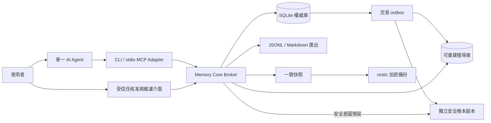

# 技術架構

狀態：MODE A 推薦設計；尚未實作。產品語意以 [DATA_CONTRACT](DATA_CONTRACT.md)為準，安全權限以 [SECURITY](SECURITY.md)為準。精確依賴版本與效能選型須通過 P0。

## 架構概覽

這是單一 Core 的模組化應用，不是多 Agent 系統或微服務。Core 不呼叫模型、不下載 URL、不自行研究；Agent 負責自然語言和推論，Core 負責確定性規則。Broker 是同一 Core 的進程入口；stdio Adapter 可被不同 Agent 啟動，不能因此直接取得權威檔案權限。

## 技術選型與邊界

| 層 | 推薦 | 依據／代價 |
|---|---|---|
| 執行環境 | CPython 3.14 x64 的受支援修補版 | 有 Windows 發布、成熟標準庫；3.15 相容性另測，不追新主版本。年度升級，不承諾同一版本維護十年 |
| Core／CLI | Python、stdlib sqlite3、argparse；明確 typed domain models | 直接交易與低依賴；不引入 ORM 或大型 Agent Framework |
| 權威資料 | 單一 SQLite DB、完整版本正文 | 將版本、來源、授權、提交收據置於同一交易；不用多檔雙寫協定 |
| 預設 journaling | `DELETE` + `synchronous=EXTRA`、單寫入者 | 單人低寫入適合簡單鎖模型；效能不足才評估 WAL，不能以降低耐久性換速度 |
| 搜尋 | 獨立 SQLite FTS5 trigram + unicode61；短詞精確掃描 | 使用成熟檢索器；具體策略見 SEARCH_DESIGN |
| Agent 協定 | 官方 Python MCP SDK，stdio | 避免自行實作 MCP；無 HTTP 服務及遠端帳號系統 |
| Windows IPC | pywin32 named pipes、明確 DACL | Broker owner SID 與 Agent SID 分離；需 P0/R 實測，非僅設定文字 |
| 交換 | 版本化 UTF-8 JSONL 完整匯出；Markdown 閱讀投影 | 可離開 Python／SQLite，Markdown 不需攜帶所有內部交易語意 |
| 備份 | sqlite3 Backup API 產生快照，再交 restic | 使用既有一致快照及加密備份工具；不自行實作加密 |
| 品質 | pytest、Hypothesis、Ruff、mypy | 不變量、故障注入與交易競爭比行數覆蓋更重要 |
| 發布 | wheel、專案 venv、鎖定依賴與 hash | 先支援 Windows 11 x64；installer / exe 打包非 MVP 必需 |

官方依據：[Python 支援週期](https://devguide.python.org/versions/)、[sqlite3](https://docs.python.org/3/library/sqlite3.html)、[SQLite atomic commit](https://sqlite.org/atomiccommit.html)、[PRAGMA](https://sqlite.org/pragma.html)、[MCP SDK](https://github.com/modelcontextprotocol/python-sdk)。這些證明工具能力，不代表本專案已通過測試。

啟動時必須讀回 PRAGMA 值，啟用 `foreign_keys`、明訂 transaction handling，檢查 runtime SQLite 功能。SQLite 不認識的 PRAGMA 可能靜默忽略。若改 WAL，必查官方 [WAL-reset 修補](https://sqlite.org/wal.html#walreset)及實際 SQLite 版本，設定 FULL 並重新測試；不能只用 Python 版本推定資料庫已修補。

## 模組與規劃目錄

以下為未來目錄，不在 MODE A 建立空殼程式。

| 模組 | 職責 | 禁止依賴／權限 |
|---|---|---|
| `domain` | Record、Revision、來源、確認與錯誤型別 | 不依賴 MCP、OS 或模型 |
| `core` | 提案、授權驗證、提交、冪等、生命週期 | 不呼叫網路或執行任意 Shell |
| `storage` | SQLite SQL、交易、遷移、snapshot、完整性驗證 | 不偷偷修改歷史正文 |
| `search` | SearchBackend、查詢解析、候選、短詞掃描 | 不能繞過 authority 可見性檢查 |
| `provenance` | 版本來源邊、循環檢查、衍生隔離閉包 | 不將來源存在判定為事實成立 |
| `analysis` | 掃描 manifest、游標、coverage、續作 | 不內建 LLM；不得用摘要假裝全量閱讀 |
| `maintenance` | outbox、重建、備份、還原、隱私清除 | 僅 owner；不暴露給普通 MCP |
| `adapters/cli`、`adapters/mcp` | 參數驗證、JSON DTO、錯誤轉換 | 無獨立商業規則、不持有私人 DB handle |
| `platform/windows` | named pipe、SID、DACL、受信任核准 | OS 呼叫與核心語意分離 |
| `tests` | 合成 fixture、模型替身、真實本機流程 | 禁止隱含真實 Vault 路徑或付費網路 |

預期工作區包含 `src/remtrace/`、`tests/`、`docs/`、`evidence/`。Vault 和正式備份預設在工作區之外且由使用者選定；MODE B 開發只用工作區中的隔離測試目錄。不得將私人檔案納入 Git、雲端同步、CI artifact 或一般 logs。

## Vault 儲存職責

| 資料 | 權威性 | 重建／備份 |
|---|---|---|
| `authority.sqlite3` | 權威：Record、Revision、來源、確認、提案、operations、lifecycle、outbox、alias、scan manifest | 必備份；無法由索引還原 |
| `search.sqlite3` | 衍生：正規化文本、FTS、排名資訊、index watermark | 可丟棄重建；仍屬敏感資料 |
| owner secrets | 核准驗證、request HMAC 與 recovery 身分材料 | 不給 Agent；須獨立安全復原安排 |
| `exports/` | 明確建立的可閱讀／交換副本 | 登記位置與來源，納入隱私刪除清單 |
| backup staging | 經 Backup API 建立的暫時快照 | 僅 owner ACL，驗證完成後清理 |
| 獨立 `safety.sqlite3` | 不隨舊 Vault 回滾的 prepared 安全意圖與 finalized 事件 | 私人模式須不同故障媒介；用途與順序見 DATA_CONTRACT |

權威 DB 保留正文 BLOB（嚴格 UTF-8）與關聯欄位；沒有同時當權威的 Markdown 樹。資料庫在本機 NTFS，拒絕網路磁碟和即時同步資料夾作正式存放點。原始檔案可閱讀性由 export/get 提供；直接編輯 export 不回寫。未來受控匯入需當新提案或明確版本修正。

## 核心介面

所有 Adapter 使用相同 application service；schema_version=1，未知欄位拒絕。不把 arbitrary SQL、檔案路徑、Shell 命令或任意 URL 下載暴露為工具。IPC 為有大小上限的 UTF-8 JSON frame，owner 與 Agent endpoint 分開。

| MCP 名稱／CLI 動詞（均規劃中） | 必要輸入 | 結果與權限 |
|---|---|---|
| `memory_propose`／`propose` | operation_id、action、payload、expected_revision／state_version（如適用） | proposal_id、digest、預覽與到期；不能自行 approve |
| `memory_commit`／`commit` | proposal_id、operation_id、digest；委派保存另附使用者指令參照 | Core 驗現行 save grant 或適用的 owner approval；回實際授權方式的 receipt，不接受 `confirmed=true` 作授權 |
| `memory_operation_status`／`operation status` | operation_id | 同 caller 的無正文結果；timeout 後先用此查詢 |
| `memory_search`／`search` | query、filter、read_grant、cursor、limit | matches、Record/Revision、來源、原文片段、watermark、查詢收據 |
| `memory_get`／`get` | record_id、revision、read_grant | 指定正文、metadata、來源狀態；預設不能讀撤回／刪除資料 |
| `memory_scan_start`／`scan start` | scope、time_axis、revision_mode、read_grant | V1 固定 manifest、scan_id、範圍計數 |
| `memory_scan_next`／`scan next` | scan_id、cursor、read_grant、budget | V1 批次、來源、下頁游標；安全狀態每次重查 |
| `memory_scan_status`／`scan status` | scan_id、read_grant | V1 coverage、未讀／失敗項目與完成狀態 |

`revision_mode` 預設 latest；歷史查詢可 explicit all 或 as_of。`as_of` 是提交序列／提交時間的歷史視圖，不是事件時間。日期 filter 明訂 `created_at` 或 `event_time`，未知事件時間另計，不自動排除並假裝完整。

owner CLI 提供 `approve`、`grant`、`deny`、`revoke`、`broker start`、`verify`、`index rebuild`、`backup create/check`、`restore stage/verify/activate`、`privacy status/purge`、`export`、`migrate`。維運命令雖可用 `remtrace` 命令群組呈現，實際必須經 owner endpoint 驗證 SID；不是只靠名稱隱藏。

沿用現有 Core／owner 介面管理持續 grant，不新增模組或額外日常審核流程。首次授權分開 read 與 save action/scope；`read_grant` 參數表示現行 grant 關聯或其連線憑證，不表示每次人工發一個新 token。正常重啟後驗同一 principal 即可沿用；撤銷／scope 變更由 Core 即時檢查。委派保存只認已登記 caller 的授權，不相信由請求自行宣告的 grant 內容。細節以 SECURITY §4–5 為準。

單筆正文最多 1 MiB，單提案 envelope 最多 2 MiB；首版一個提案只變更一個 Record，但可引用多個既有版本。查詢預設 20 筆、上限 100；get 超出回覆預算以 byte range 讀取，切在 UTF-8 邊界。任何截斷都標 `truncated` 和 `next_cursor`。預覽不得隱藏正式提交的尾段，需讓人展開完整內容。

## 一致性與資料流

1. Core 接收並驗證輸入，保存不可變提案；不把此步標為長期記憶保存成功。
2. 對使用者明確要求、且在有效委派內的日常保存，Core 驗證 Agent／save scope 並為該提案授權，免重複人工確認；未委派操作維持 owner 介面的完整預覽與核准。
3. Core 單一 transaction 重查現行 grant 或適用的 owner approval、目標版本及來源可見性，寫入版本、來源、實際確認方式、收據與 outbox。COMMIT 成功才回 `committed`；save 委派不產生原文／事實確認。
4. 索引 worker 從權威 outbox 取得任務；每個 search DB transaction 更新對應版本並推進 watermark，完成後才 ACK。重複執行不重複新增。
5. index 尚未完成時結果為 `committed` / `pending`；get 可立即取回。search 可掃描 authority 補齊或回明確 incomplete，不能謊報不存在。
6. 刪除與撤回先在 authority 封鎖可見性，再做索引／副本清理；搜索片段永遠從目前允許的權威版本產生，不能直接轉交舊索引片段。

Core 僅一個 writer；`BEGIN IMMEDIATE` 競爭以有界 timeout 處理。Read 交易短暫；聚合不持有數分鐘 transaction，改以不可變版本 ID manifest 固定視圖。索引替換需關閉舊 handle、在 staging 驗證並以 generation 切換；途中失敗使用原 generation 或精確掃描，不改權威庫。

## 錯誤與重試介面

回傳統一 envelope：`api_version`、`request_id`、`ok`、`result` 或 `error{code,retryable,message}`。operation 回傳 `commit_state`、`record_id`、`revision`、`commit_seq`、`index_state`、`safety_mirror_state`，不在正常 log 放正文。

| 錯誤碼 | 動作 |
|---|---|
| `INVALID_INPUT`、`UNSUPPORTED_SCHEMA` | 修正輸入；不可自動丟棄未知欄位 |
| `APPROVAL_REQUIRED`、`APPROVAL_EXPIRED`、`READ_GRANT_REQUIRED` | 僅缺授權、到期或未委派操作才由 owner 處理；有效持續 grant 不因新會話要求確認 |
| `REVISION_CONFLICT`、`STATE_CONFLICT` | 讀取被允許的現況並重建新提案；Core 重新檢查授權，符合原意圖及委派 scope 時免重複人工確認 |
| `IDEMPOTENCY_CONFLICT` | 停止；同 operation_id 不得改內容 |
| `SOURCE_UNAVAILABLE` | 不轉成無來源推論；保留待處理提案 |
| `BUSY`、`IO_FAILURE` | 查 operation_status；只有確認未提交才以同 ID 重試 |
| `INDEX_STALE`、`INDEX_UNAVAILABLE` | 明示降級／補掃描，不能當作查無資料 |
| `RESTORE_RECONCILIATION_REQUIRED` | 維持隔離，不啟動 MCP |
| `SAFETY_LEDGER_UNAVAILABLE` | 不回報撤回／刪除成功；暫停 Agent 讀取，恢復獨立帳本後續作 |

CLI exit code 規劃：0 成功（提交成功但索引 pending 仍為成功，JSON 明示）；2 輸入；3 授權；4 衝突；5 暫時／未知結果；6 完整性／恢復阻擋。MCP 使用工具錯誤結果而非把 domain error 包成協定崩潰。工具 annotations 僅為提示，見 [MCP tools 規格](https://modelcontextprotocol.io/specification/2025-11-25/server/tools)。

## 長期可維護性

核心不依賴模型特有記憶。adapter、SearchBackend、BackupProvider 保持窄介面；migration 版本與 export format 版本分離。每年檢查 Python、SQLite、SDK 支援週期，重大升級先在合成庫及備份副本測試。先保留移出本系統的能力，再考慮新增功能。

無損匯出、跨版本還原與 25k 壓力是維護成本的早期指標。若依賴不再維護、Windows 安裝必須自編大量原生套件，或 CJK 門檻無法達到，依 DECISIONS 的重審條件換 backend，不改 Record 身分與來源語意。
