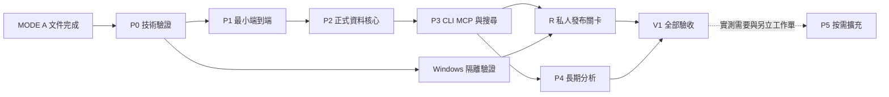

# 自主開發主計畫

狀態：MODE A 文件計畫。**目前未授權產品實作。** 使用者後續新訊息明確輸入「執行」才啟動 MODE B；「繼續」只延續當前文件工作。

## 1. 範圍與依賴

MVP = P0–P3 的必要能力加 R 發布關卡；P1 只是垂直切片。正式 V1 = MVP + P4 + 完整驗收；P5 非必要。R 受環境／權限阻擋時可以繼續合成資料 P4，不可宣稱私人 MVP/V1 已完成。

每工作單狀態使用 `not_started → in_progress → implemented → verified`；另有 `blocked`／`failed`。只有 evidence 可追溯才 verified。實際狀態唯一來源為 [PROGRESS](PROGRESS.md)，本文件不重複勾選完成狀態。

## 2. P0：技術驗證與選型封版

前置：收到正式 MODE B 授權，讀完最小必要文件，檢查空工作區及現有修改。只用合成資料；可建立可丟棄 spikes 和 fixture，不能使用私人庫。

| 工作單 | 交付 | 依賴 | 驗收／證據 |
|---|---|---|---|
| P0.1 環境與版本 | Python／SQLite／MCP／restic／Windows 能力清單、依賴 lock 與安裝來源 | MODE B | 實際 version、compile options、trigram、API smoke，無付費 API |
| P0.2 現成方案契約 probe | 固定版本的 Basic Memory extension 成本比較；必要時 gbrain 對照 | P0.1 | W03/04、來源版本、P05 的小型可重現 probe；不需要複製整套產品 |
| P0.3 資料交易 spike | immutable revision、原文字節、digest vectors、CAS、receipt/outbox；委派保存的現行 grant 檢查 | P0.1 | D01/02/05、W01–05/10/11、S13、F 的 commit 前後切點通過 |
| P0.4 CJK 對照 | 固定 F-small／Q labels；rg、FTS5、Tantivy+Lindera 比較報告 | P0.1 | Q01–04、L 短詞與索引；精確環境／候選版本與失敗題 |
| P0.5 Windows 信任邊界 | named pipe／SID／trusted session 實驗和首選 Agent 可行性 | P0.1；系統變更需必要權限 | S01–06/11 的真實 OS 證據；無權限則明列 R blocker |
| P0.6 復原／刪除 spike | primary+safety mirror 中斷、舊 snapshot 合併、missing-ledger 拒絕 | P0.3 | B03/04/06、P05；資訊無法恢復情境確實 fail closed |
| P0.7 更新 ADR | 實驗結果、固定採用版本、必要規格修正 | P0.2–04/06；P0.5 可留隔離 blocker | 不改產品原則、不降低資料完整性；列清楚 unresolved gates |

進入 P1：資料不變量和最小搜尋可行；P0.2 未發現更低風險現成窄擴充路徑。FTS5/Tantivy 若一項安裝受限，可先保留精確掃描作 synthetic prototype，但 Q/L 不算通過。若原文／交易／確認一致性無可行方案，停止相依實作並記錄最小阻礙。

可並行：P0.2、P0.4、P0.5 是獨立評估；程式定稿不得早於 P0.3/6。這描述工作依賴，不要求產品或開發必須採多 Agent。

## 3. P1：最小端到端垂直流程

| 工作單 | 交付 | 依賴 | 驗收 |
|---|---|---|---|
| P1.1 專案骨架與 schema v1 | wheel entrypoints、domain types、authority init、synthetic guard、品質工具 | P0.7 | I 的本機安裝 smoke；D 基本 schema，不建立無功能空殼完成標記 |
| P1.2 提案與持續授權 | immutable proposal、首次 read/save grant、委派保存與未委派操作的 owner 確認、preview、獨立三種 scope；沿用 Core/owner 介面 | P1.1 | D05、W03/06/09–11、S13；dev provider 僅合成測試 |
| P1.3 正式新增 | 單筆 transaction、operation receipt、最小 outbox、get | P1.2 | D01/04、W01/02、commit 故障切點 |
| P1.4 找回與會話重啟 | 最小搜尋、CLI 及最小 MCP tool set | P1.3、P0.4 | E01/E02；E03 能實測則實測，不因 mock 通過假稱已整合 |

階段交付：首次授權後，一段合成原文從使用者明確要求保存、委派授權、commit、新 process／新 Agent 會話沿用讀取授權搜尋、正確 Record/Revision 引用的完整證據；日常保存與新會話不新增人工確認，未委派操作另驗 owner 路徑。**不包含假裝已完成刪除、完整恢復或安全私人部署。**

進入 P2：E01/E02 和核心 D/W 通過；E03 如果需要使用者開新會話可記待驗證，仍可做不依賴實際模型的資料核心。不能宣稱 P1 整體驗證已完成。

## 4. P2：正式資料核心

| 工作單 | 交付 | 依賴 | 驗收 |
|---|---|---|---|
| P2.1 版本與來源 | amend、來源邊、fidelity、時間精度、確認追加 | P1 | D01–10、W04/05/07 |
| P2.2 生命週期 | withdraw/reinstate、privacy quarantine、衍生閉包、purge job | P2.1 | P01–04/06、S 讀取 gate integration |
| P2.3 索引一致性 | durable outbox、index watermark、failure/status、重建 | P2.1，可與 P2.2 並行 | F 全相關切點、Q05/06 |
| P2.4 交換與 migration | JSONL／Markdown export、受控 import、schema version migration | P2.1/2 | M01–03、D01 引用往返 |
| P2.5 加密備份及安全鏡像 | snapshot+manifest、restic、latest safety ledger、staged restore | P2.2/4、P0.6 | B01–06、P05；乾淨還原及 missing-ledger fail closed |
| P2.6 故障與清除整合 | 所有中斷續作、磁碟滿、權威毀損、受控副本清理 | P2.1–05 | D/W/F/P/B/M 核心全通過 |

進入 P3：P2.6 綠燈；無丟失已提交資料、越權可見性或復活缺陷。未實作 purge／restore 的支線不得被忽略後當作 MVP。

## 5. P3：完整 Agent 與中日英搜尋

| 工作單 | 交付 | 依賴 | 驗收 |
|---|---|---|---|
| P3.1 CLI/MCP 契約封版 | schema、工具列表、錯誤／status／取消、正式文件例子 | P2.6 | E01–03、W 重試；至少一實際 Agent 新會話 |
| P3.2 搜尋與 alias | trigram/token/短詞、來源分組、snippet、日期與歷史 filters | P2.3、P0.4 | Q 全套達門檻 |
| P3.3 Agent 路由 | 三種 query policy、來源識別、失敗處理、預設不保存 | P3.1/2 | A01–03、S06/07 |
| P3.4 規模／打包 | 5k/12k/25k、可重現 wheel、依賴與手冊 | P3.1–03 | L/I、backup RTO，無未知嚴重失敗 |

階段完成只稱「MVP 功能候選」，私人資料仍須 R。Q/L 未達門檻按 SEARCH_DESIGN 分析，不能用宣稱語義模型會解決來跳過。

## 6. R：私人發布與運維安全

| 工作單 | 交付 | 依賴 | 驗收 |
|---|---|---|---|
| R.1 owner/Agent 安裝與權限 | 受控程式路徑、不同 SID、pipe DACL、可信 session、持續授權及撤銷 | P0.5、P3；必要 OS 操作另有權限 | S01–13，包含 Agent 實際 Shell 嘗試、正常重連與委派限制揭露 |
| R.2 安全備份演練 | 獨立測試媒體／乾淨機恢復、safety freshness、VM 斷電 | P2.5、R.1 | B/F/P 全通過；無真實資料 |
| R.3 發布封版 | 安裝／移除／升級、版本清單、實測限制、所有證據索引 | P3.4、R.1/2 | ACCEPTANCE 的 MVP 全項；文件與 `--help` 一致 |

通過 R 只是軟體具備私人部署資格；使用者尚未授權的真實 Vault、付費服務、雲端備份／發布仍不得操作。外部發布／推送不是這份自動開發計畫的隱含步驟。

## 7. P4：正式長期記憶能力

| 工作單 | 交付 | 依賴 | 驗收 |
|---|---|---|---|
| P4.1 snapshot 範圍掃描 | manifest、keyset cursor、完整 byte ranges、續作、即時 safety gate | P3 | G coverage、取消／重啟／新增／刪除競爭 |
| P4.2 分析工作流 | 時間軸、反例、缺口、證據閉包、來源引用 | P4.1 | 12 題 G 金標，無捏造或省略必要反例 |
| P4.3 按需衍生與成本 | 提案保存分析、summary cache 可選、token evidence | P4.2 | G Token 門檻或停用無效最佳化；D/P 回歸 |
| P4.4 V1 封版 | 完整安裝至長期分析驗收與交接 | P4.1–03、R | ACCEPTANCE V1 全部已驗證 |

P4 可在 R 等待必要權限時用合成環境前進；模型品質驗證若無合法可用模型，需保留未驗證 gate。不可用自己書寫的示範答案假稱產品分析完成。

## 8. P5：按需擴充，不自動開發

必須有已觀察問題、候選方案、成本、測試與獨立批准的工作單才開始。候選：本機 Embedding、重要 Claims/Evidence、有限 Knowledge Graph、活動 State Projection、使用者指定重分析、保守智慧觸發。不能因「下一個階段」而強制增加功能。

## 9. 自動續作與阻礙

MODE B 中，完成一項已核准工作即更新 PROGRESS／證據並選下一個依賴滿足的工作，不要求逐步「繼續」。只能在重大需求矛盾、必要權限、不可逆操作、敏感資料／付費服務、或有證據的外部阻礙時暫停該支線。

局部阻礙不等於全專案重設；先完成其他可獨立工作。若需使用者決定，提供已準備好的具體選項、原因、影響與最小權限，而非抽象詢問「要繼續嗎」。工具中斷時記錄最後成功 run、未完成 mutation、下一指令及應先確認的操作結果。

難點預估：Windows trusted session 與首個 Agent 的使用體驗、隱私衍生閉包及 backup 防復活為高風險；CJK 短詞與排名、長期分析 coverage 為中高風險；CLI／schema／普通 CRUD 為中風險。P0 完成前不給看似精確的日程承諾；先以 gate 判定可行，再按實驗工作量估時。
